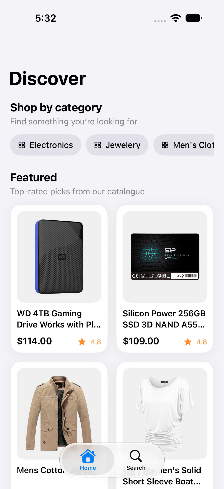
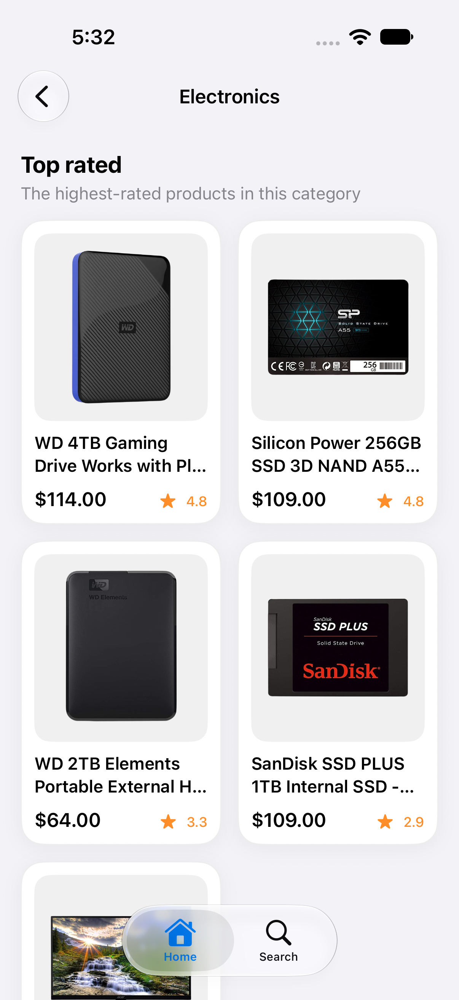
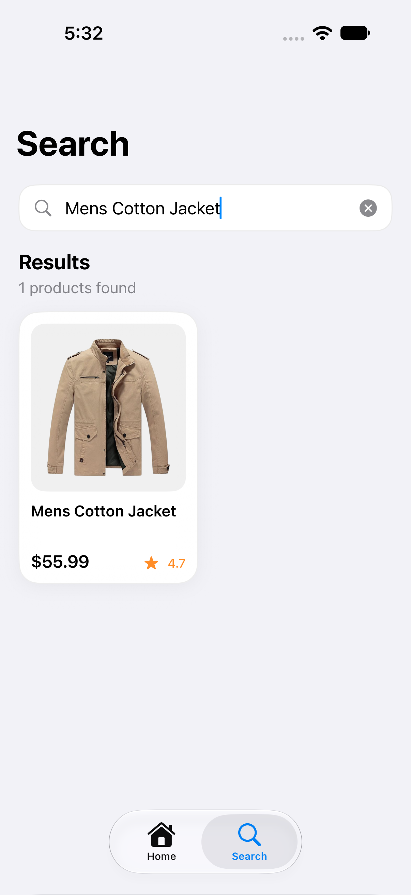
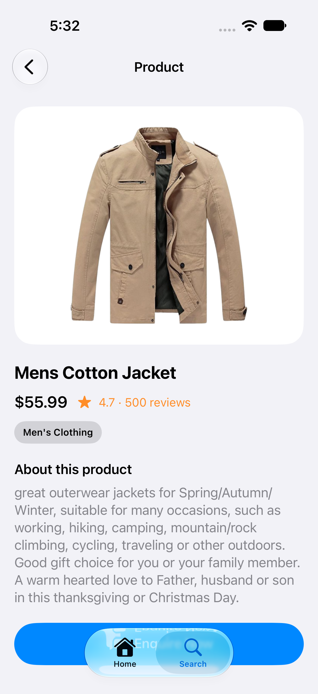
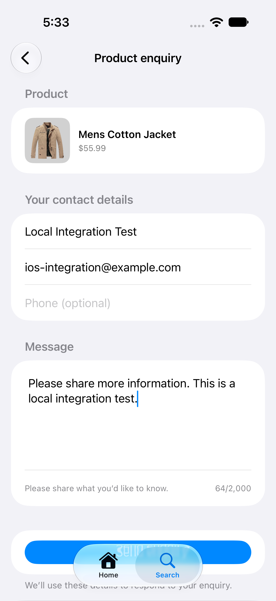
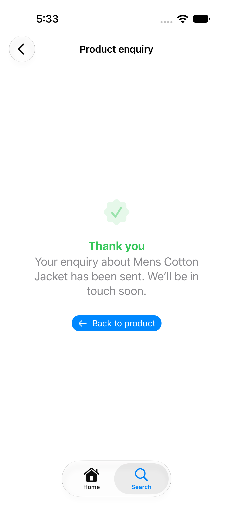

# Product Catalogue

A small iOS product catalogue backed by an Express API. The iOS app uses the backend for all product and enquiry requests; only the backend talks to Fake Store API. Enquiry email is delivered synchronously through a replaceable email-provider interface, with Mailpit used for local development.

## Problem statement

The assessment asks for a browseable catalogue with featured products, categories, search, product details, and an enquiry flow. It also requires a replaceable product source and email provider, a clear boundary between UI and data access, and useful automated tests.

## Implemented features

- Home screen with categories and five featured products.
- Category screen with five highest-ranked products and the remaining category products.
- Debounced search across product title, description, and category.
- Product details with image, price, category, description, and rating.
- Enquiry form with client-side usability validation, duplicate-submit protection, and success/error states.
- Backend validation, product existence checks, generic provider errors, and a short-lived in-memory product cache.
- Local SMTP delivery through Nodemailer to Mailpit.

## Technology choices

- iOS: Swift 6, SwiftUI, Observation, iOS 18.6 deployment target, XCTest, and Swift Testing.
- Backend: Node.js, Express, TypeScript, Zod, Vitest, and Supertest.
- Networking: URLSession and async/await on iOS; Fetch in the Fake Store adapter.
- Email: Nodemailer over SMTP; Mailpit for local capture.

## Architecture overview

SwiftUI screens observe their feature ViewModels. ViewModels call repository protocols; repository implementations use a small API client. The Express composition root injects a product repository into product and enquiry services, and an email provider into the enquiry service. See [docs/architecture.md](docs/architecture.md) for the component and request-flow diagrams.

## Repository structure

```text
product-catalogue/
├── ios/
│   ├── catalogue-management.xcodeproj/
│   ├── catalogue-management/          # App, features, domain, data, design system, DI
│   ├── catalogue-managementTests/     # XCTest and Swift Testing
│   ├── catalogue-managementUITests/
│   └── Config/Info.plist
├── backend/
│   ├── src/
│   ├── tests/
│   ├── package.json
│   └── .env.example
├── docs/
│   ├── architecture.md
│   └── screenshots/
├── AGENTS.md
├── AI_USAGE.md
├── DECISIONS.md
└── README.md
```

## How iOS communicates with the backend

The app’s `API_BASE_URL` build setting defaults to `http://127.0.0.1:3000`. When an iOS app runs in the Simulator, `127.0.0.1` reaches the Mac host, where the backend is listening. On a physical device, use an HTTPS backend address and set that build setting accordingly; the client intentionally rejects plain HTTP for non-loopback hosts.

The app does not contain a Fake Store API URL and does not make requests to Fake Store API. Native iOS requests do not depend on browser CORS.

## API endpoints

All catalogue and enquiry routes are versioned at `/api/v1`. `/health` is unversioned.

- `GET /health` → `{"status":"ok"}`
- `GET /api/v1/products/featured` → `{"data":[Product, ...]}`
- `GET /api/v1/categories` → `{"data":["electronics", ...]}`
- `GET /api/v1/categories/:category/products` → `{"data":{"category":"electronics","featured":[Product, ...],"remaining":[Product, ...]}}`
- `GET /api/v1/products/search?q=bag` → `{"data":[Product, ...],"meta":{"query":"bag","count":1}}`
- `GET /api/v1/products/:id` → `{"data":Product}`
- `POST /api/v1/enquiries` → HTTP 201 and `{"data":{"status":"sent"}}` after SMTP accepts the message.

A product is shaped as:

```json
{
  "id": "1",
  "title": "Product title",
  "description": "Product description",
  "category": "category-name",
  "imageUrl": "https://example.test/image.jpg",
  "price": 19.99,
  "rating": { "rate": 4.5, "count": 120 }
}
```

The enquiry body uses a positive integer `productId`, required `name`, `email`, and `message`, and optional `phone`. The common error shape is `{"error":{"code":"VALIDATION_ERROR","message":"The request is invalid.","details":[]}}`; status and code vary by error. See [docs/architecture.md](docs/architecture.md#http-api) for the request example, validation limits, and error statuses.

## Prerequisites

- macOS with Xcode and an available iOS Simulator runtime.
- Node.js and npm. This project was verified with Node.js 24.21.0 and npm 11.9.0.
- Internet access for the backend to retrieve Fake Store API data and for initial package installation.
- Mailpit for local enquiry email capture.

## Backend installation and startup

From the repository root:

```sh
cd backend
npm ci
cp .env.example .env
npm run dev
```

The backend listens at `http://127.0.0.1:3000` with the example configuration. The `.env.example` values are non-secret local defaults. Adjust `.env` for a different port or SMTP service. Do not commit `.env`.

In another terminal, the backend checks are:

```sh
cd backend
npm test
npm run typecheck
npm run build
```

## Mailpit setup and email testing

Install Mailpit with Homebrew, then bind both local services to loopback:

```sh
brew install mailpit
mailpit --listen 127.0.0.1:8025 --smtp 127.0.0.1:1025 --disable-version-check
```

The backend example configuration uses SMTP `127.0.0.1:1025`. Open `http://127.0.0.1:8025` to inspect captured messages. Mailpit stores test messages locally; it does not deliver them to a real mailbox. The API returns success after the SMTP server accepts the message, which is not a guarantee of inbox delivery in a production provider.

## iOS Simulator setup and execution

Start the backend and Mailpit first. Open `ios/catalogue-management.xcodeproj` in Xcode, select the `catalogue-management` scheme and an iOS Simulator, then run the app.

The checked-in project setting is `API_BASE_URL=http://127.0.0.1:3000`. To use another backend, update the app target’s `API_BASE_URL` build setting. Do not point iOS to Fake Store API.

Verified simulator build command:

```sh
xcodebuild build \
  -project ios/catalogue-management.xcodeproj \
  -scheme catalogue-management \
  -destination 'generic/platform=iOS Simulator' \
  -derivedDataPath /tmp/product-catalogue-derived \
  CODE_SIGNING_ALLOWED=NO
```

## Running automated tests

Backend tests, typecheck, and production build:

```sh
cd backend
npm test
npm run typecheck
npm run build
```

Run the complete iOS test suite on an installed simulator (replace the simulator name if needed):

```sh
xcodebuild test \
  -project ios/catalogue-management.xcodeproj \
  -scheme catalogue-management \
  -destination 'platform=iOS Simulator,name=iPhone 18 Pro' \
  -derivedDataPath /tmp/product-catalogue-derived \
  CODE_SIGNING_ALLOWED=NO
```

The live product-to-enquiry UI test runs when the local backend, Fake Store-backed search, and Mailpit are reachable; it skips when those local services are unavailable. Backend route tests and iOS unit tests use test doubles and do not require live SMTP.

## Screenshots

The following screenshots were captured from the iOS Simulator during the live integration UI flow. The enquiry form and product detail captures show the app before the final tab-bar visibility adjustment; the final adjusted build compiled, but a repeat simulator UI run could not complete because CoreSimulator stalled.

| Home | Category | Search |
|---|---|---|
|  |  |  |

| Product details | Enquiry form | Thank you |
|---|---|---|
|  |  |  |

## Assumptions and limitations

- Featured products are selected by rating descending, rating count descending, then product ID ascending; fewer than five source products are returned when the source itself has fewer.
- Search is case-insensitive substring matching with trimmed query input; it has no relevance ranking, typo tolerance, or pagination.
- The full catalogue is held in a process-local memory cache for 60 seconds by default. It is not persistent or shared across backend instances.
- Enquiries are not persisted. Delivery is synchronous, and the response is tied to SMTP acceptance.
- The iOS deployment target in the actual Xcode project is iOS 18.6. Physical-device networking and a production email service were not verified.
- Authentication, payment, administration, database persistence, queues, and production deployment are outside this MVP.

## AI tooling disclosure

OpenAI Codex was used as an engineering assistant for planning, implementation, review, and documentation. The prompts and verified corrections are summarized in [AI_USAGE.md](AI_USAGE.md). No separate external AI coding tool is recorded.

## Time spent

Time was not tracked during the milestone-based AI-assisted work, so no estimate is reported.
