# Product Catalogue Architecture

## System context

The iOS app communicates only with the versioned Express backend. The backend reads catalogue data through a replaceable `ProductRepository`; its current adapter fetches Fake Store API, validates the payload, maps it into backend DTOs, and caches the catalogue briefly. Enquiries are validated and checked against that repository before an `EmailProvider` sends a message through SMTP. The current provider is Nodemailer and the local SMTP endpoint is Mailpit.

```mermaid
flowchart LR
    subgraph iOS[SwiftUI iOS application]
      Views[SwiftUI screens] --> VMs[Observable ViewModels]
      VMs --> Repos[Product and Enquiry repository protocols]
      Repos --> API[URLSession APIClient]
    end
    API -->|HTTP JSON /api/v1| Routes[Express routes]
    Routes --> Services[ProductService / EnquiryService]
    Services --> ProductRepo[ProductRepository interface]
    ProductRepo --> FakeStore[FakeStoreProductRepository]
    FakeStore -->|HTTPS| Source[Fake Store API]
    Services --> Email[EmailProvider interface]
    Email --> Nodemailer[NodemailerEmailProvider]
    Nodemailer -->|SMTP| Mailpit[Mailpit local SMTP]
```



## iOS architecture

- `Features/` contains Home, Category, Search, Product Detail, and Enquiry SwiftUI screens and their `@Observable`, `@MainActor` ViewModels.
- `Domain/Models/` contains product, rating, category, enquiry, and load-state types. Product IDs are strings; enquiry `productId` is an integer after safe conversion at the form boundary.
- `Domain/Repositories/` defines product and enquiry contracts.
- `Data/Networking/` contains `APIClient`, `URLSessionAPIClient`, transport boundary, typed `APIError`, request construction, status validation, and JSON coding.
- `Data/Repositories/` maps versioned backend wire DTOs into domain models and issues requests through `APIClient`.
- `DesignSystem/` contains reusable product cards, grids, category chips, and loading/error/empty presentation.
- `DI/AppContainer.swift` composes the API client and repositories. The app reads `APIBaseURL` from Info.plist, substituted from the `API_BASE_URL` build setting.

The UI uses `NavigationStack`, with Home and Search as root tabs. Search waits briefly while typing, then calls the repository; the Search ViewModel’s request generation and cancellation handling prevent stale results from replacing newer state. Home, Category, and Product Detail also use generation checks for overlapping loads. EnquiryViewModel validates input and rejects a second submission while one is active.

## Backend architecture

- `src/app.ts` creates the Express app without opening a listener. `src/server.ts` loads configuration and starts the runtime server.
- `src/config/env.ts` validates environment configuration, including JSON body size and SMTP settings.
- `src/di/container.ts` constructs the product repository, product service, email provider, and enquiry service.
- `src/http/routes/` validates HTTP input, calls services, and serializes the stable API envelopes.
- `src/products/product.service.ts` selects featured products, lists categories, partitions category products, searches, and retrieves details using only `ProductRepository`.
- `src/products/fake-store-product.repository.ts` is the only production source file that calls Fake Store API. It validates and normalizes upstream data, handles timeouts/failures, reuses concurrent fetches, and applies a short in-memory TTL cache.
- `src/enquiries/enquiry.service.ts` verifies the product, then calls `EmailProvider`. `NodemailerEmailProvider` formats the notification and sends via configured SMTP.
- `src/http/middleware/errors.ts` maps known errors into a common JSON error envelope and keeps unexpected error details out of client responses.

## Dependency injection and replacement seams

The iOS app uses explicit constructor injection in `AppContainer`; repositories depend on the `APIClient` protocol. Backend services receive repository/provider interfaces through the composition root. Tests inject fake implementations. Replacing Fake Store requires a new `ProductRepository` adapter and composition change, not a `ProductService` rewrite. Replacing SMTP requires a new `EmailProvider` implementation and composition change.

## Request and response flow

### Catalogue request

1. A SwiftUI screen observes its ViewModel.
2. The ViewModel calls `ProductRepository`.
3. The repository builds a versioned request through `APIClient`.
4. Express routes validate path/query input and invoke `ProductService`.
5. The service asks `ProductRepository` for normalized products.
6. The backend maps the service result into a JSON `data` envelope; iOS decodes a wire DTO and maps it into domain models.

### Enquiry delivery

1. The form submits name, email, optional phone, message, and a safe positive numeric product ID.
2. `EnquiryViewModel` prevents duplicate active submissions and validates form values.
3. `EnquiryRepository` posts JSON to the backend.
4. The route applies the Zod schema; `EnquiryService` verifies that the product exists.
5. `EmailProvider` sends through Nodemailer to configured SMTP.
6. Only after provider acceptance does the backend return HTTP 201. iOS then enters the thank-you state. Validation, missing-product, and delivery failures do not show success.

## HTTP API

Base path: `/api/v1`. JSON keys use `camelCase`. `/health` is outside the versioned path.

### Product object

```json
{
  "id": "1",
  "title": "Product title",
  "description": "Product description",
  "category": "category-name",
  "imageUrl": "https://example.test/image.jpg",
  "price": 19.99,
  "rating": { "rate": 4.5, "count": 120 }
}
```

### Endpoints

- `GET /health` → HTTP 200: `{"status":"ok"}`.
- `GET /api/v1/products/featured` → HTTP 200: `{"data":[Product,...]}`. Returns up to five products ranked by rating descending, rating count descending, then product ID ascending.
- `GET /api/v1/categories` → HTTP 200: `{"data":["electronics",...]}`; category strings are lexically sorted.
- `GET /api/v1/categories/:category/products` → HTTP 200: `{"data":{"category":"electronics","featured":[Product,...],"remaining":[Product,...]}}`. `featured` contains up to five top-ranked products. `remaining` has every other product once, preserving rank order. Unknown category returns HTTP 404.
- `GET /api/v1/products/search?q={query}` → HTTP 200: `{"data":[Product,...],"meta":{"query":"bag","count":1}}`. The trimmed query matches case-insensitive substrings in title, description, or category; results are ordered by product ID ascending. Missing, empty, or invalid query returns HTTP 400.
- `GET /api/v1/products/:id` → HTTP 200: `{"data":Product}`. ID must be a positive decimal string; malformed IDs return HTTP 400 and missing products HTTP 404. Search route is registered before the `:id` route.
- `POST /api/v1/enquiries` accepts:

```json
{
  "productId": 1,
  "name": "A. Customer",
  "email": "customer@example.com",
  "phone": "+15550100",
  "message": "Please contact me about availability."
}
```

  `productId` must be a positive safe integer. `name` is required (1–100 characters), `email` is required and valid (up to 254), `phone` is optional (up to 30, normalized to E.164 when provided), and `message` is required (1–2,000). Success returns HTTP 201: `{"data":{"status":"sent"}}`. Missing product returns 404; validation returns 400; provider failure returns generic 502.

### Error envelope

```json
{
  "error": {
    "code": "VALIDATION_ERROR",
    "message": "The request is invalid.",
    "details": []
  }
}
```

Known public errors include `NOT_FOUND`, `PRODUCT_NOT_FOUND`, `CATEGORY_NOT_FOUND`, `UPSTREAM_ERROR`, `EMAIL_DELIVERY_FAILED`, `VALIDATION_ERROR`, `PAYLOAD_TOO_LARGE`, and `INTERNAL_SERVER_ERROR`. Malformed JSON returns 400; oversized JSON returns 413. Unexpected error messages and stacks are not returned to clients.

## Configuration and local networking

Backend defaults are in `backend/.env.example`: host `127.0.0.1`, port `3000`, 100kb JSON body limit, Fake Store HTTPS origin, 60,000ms cache TTL, 5,000ms upstream timeout, and local Mailpit SMTP host/port `127.0.0.1:1025`. Copy it to `.env` for local use; `.env` is ignored by Git.

The iOS simulator uses `http://127.0.0.1:3000` to reach the Mac host. CORS is configured for browser clients but native iOS does not rely on CORS. For physical devices, configure a reachable HTTPS API origin; plain HTTP is intentionally limited to loopback by the client.

## Test boundaries

Backend unit and Supertest tests cover service rules, adapter mapping, route envelopes, errors, and validation using fakes. iOS tests cover API client, repository mapping, and ViewModel behavior with test doubles. A local-services UI integration test exercises category navigation, Search, product details, SMTP enquiry acceptance, and confirmation when backend/Fake Store/Mailpit are available; it skips if those local dependencies are absent.
